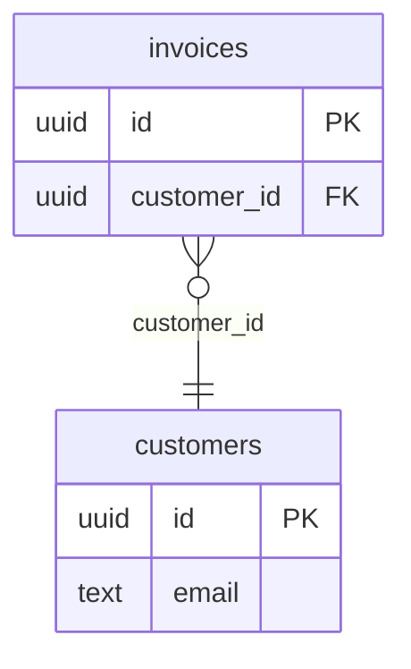

# Kits

A canvas draws anything: your `:node` slots draw your nodes (see
[Nodes](nodes.md)), and a canvas needs nothing else. A kit is a way to
package one kind of canvas, so that it is used in one line, by one app or
by many: its nodes and how they look, how people make and edit them, its
paper, the rules of its edges, and how it reads and writes as Markdown.

Kits are optional. Hakushi has five, and you write your own with the same
callbacks (`Hakushi.Kit`).

## The kits of Hakushi

| Kit | Nodes | People edit | Paper |
| --- | --- | --- | --- |
| `Hakushi.Kits.Schema` | tables (`"schema-table"`), their columns, and foreign keys from a column to a column of its family of types (`integer` to `bigint`); stubs of tables of another schema | the table's and columns' names, a column's type and key, adding and removing columns | graph paper |
| `Hakushi.Kits.Flow` | a trigger, steps, and conditions with two ways out (`"flow-trigger"`, `"flow-step"`, `"flow-condition"`) | the title and the detail | dots |
| `Hakushi.Kits.Notes` | sticky notes (`"note"`) in five colours, which resize | the text, the colour | crosses, snapped |
| `Hakushi.Kits.Ink` | strokes of a pen or a highlighter (`"ink-stroke"`), drawn over anything | drawing, erasing, lassoing, with a bar of tools on the canvas | the canvas's |
| `Hakushi.Kits.Shapes` | rectangles, ellipses, diamonds, triangles and text (`"shape"`), and lines (`"shape-line"`) | drawing them with the bar of tools, their text in place, their style from a panel, turning and resizing them | the canvas's |
| `Hakushi.Kits.Images` | images (`"image"`), uploaded through the app | dropping, pasting or picking them, resizing with their aspect ratio, cropping, a caption and alt text | the canvas's |

## Use a kit

```heex
<.canvas id="model" graph={@graph} kits={[Hakushi.Kits.Schema]} on_change={&save/2} />
<.kit_items for="model" kits={[Hakushi.Kits.Schema]} />
```

The canvas draws the kit's nodes (where you have no `:node` slot of
their type: yours wins), and makes them: a kit's item (`kit_items/1`)
dropped on the canvas or clicked makes its node, and a double click on
the paper makes the first kit's first. You give no `new_node`.

An edit of a kit's node (a column renamed, a note's colour) is a change
of the person's own, as a move is: it goes through your rules and
`on_change`, ⌘Z undoes it, and on a shared canvas everyone sees it.

A canvas may have several kits (`kits={[Schema, Notes]}`): their nodes
on one paper, with the first kit's paper and every kit's rules.

### Ink

Ink is drawn, not dropped: a canvas with `Hakushi.Kits.Ink` has a bar of
tools at its top, and its items (`kit_items/1`) are none.

```heex
<.canvas id="board" graph={@graph} kits={[Hakushi.Kits.Notes, Hakushi.Kits.Ink]} on_change={&save/2} />
```

| Tool | Key | What it does |
| --- | --- | --- |
| Pointer | V, Escape | selects and drags, as usual |
| Pen | P | draws a line, in a colour and a width of the bar, thinner and thicker with a stylus's pressure |
| Highlighter | H | draws a wide line of one width, that lets what is under it show |
| Eraser | E | deletes the strokes it passes over (⌘Z brings them back) |
| Lasso | L | selects what a line drawn around encloses, strokes and nodes alike: drag them, copy them, delete them |

The line is smoothed as it is drawn, and simplified when the pen lifts:
it is then a stroke, a node whose data is its points, relative to its box
(see `Hakushi.Kits.Ink`). It goes through your rules and `on_change` as
any node, in the frame or group it is drawn over, and ⌘Z takes it back.
The box of a stroke takes no clicks, only its line: a ring drawn around a
node leaves the node to click. Once a pen is used on the canvas, a finger
pans, and only the pen draws.

`Hakushi.Kits.Ink.stroke/2` makes a stroke's node from points of the
canvas, for your app's own drawings; `Hakushi.Test.draw/5` draws in a
test as a pen does.

On a shared canvas, the others see a line as it is drawn, and an agent
draws with `draw_on_canvas` (see the [Collaboration](collaboration.md)
guide).

### Shapes

Shapes are drawn with the bar of tools too, for diagrams, wireframes and
whiteboards with no `:node` slot of yours:

```heex
<.canvas id="board" graph={@graph} kits={[Hakushi.Kits.Shapes, Hakushi.Kits.Ink]} on_change={&save/2} />
```

| Tool | Key | What it does |
| --- | --- | --- |
| Rectangle, ellipse, diamond, triangle | R, O, D | a drag on the paper draws the shape (Shift: a square, a circle); a click, one of the kind's size |
| Text | T | a click or a drag: text with no box, written at once |
| Line | A | from a point to a point, an arrow unless styled otherwise: an edge, when it goes from a shape to a shape (it follows them), else a straight line of its own (for lines drawn by hand, add `Hakushi.Kits.Ink`) |

The pointer is back once a shape is drawn, with the shape selected. A
double click on a shape writes its text in place (centred and wrapped;
the shape grows with a longer text; Escape takes it back). A selected
shape resizes by its corners and sides, and turns by the knob above it
(Shift: by 15°). A panel beside the selection has the style of the shapes
selected (fill, stroke, its width and dash, corners, text size and
alignment, a line's arrows), for one or many, in one change. Each shape
has a handle on each side, so a flowchart of shapes is Hakushi's edges
and rules as they are.

Two kits' tools with one letter: the letter takes the first, and again
the next, in turn.

Its colours are the theme's (`--hakushi-shape-<name>`), and your own (see
`Hakushi.Kits.Shapes`). `Hakushi.Kits.Shapes.shape/3` and `line/3` make
the nodes for your app's own drawings; `Hakushi.Test.draw_box/5` draws as
a drag does, and `edit/5` with a list of nodes styles them as the panel
does. In Markdown, shapes are a Mermaid flowchart.

### Images

Images are files people drop on the paper, paste, or pick with the kit's
tool (I), for a moodboard, a screenshot to mark up, references beside a
plan:

```heex
<.canvas id="board" graph={@graph} kits={[Hakushi.Kits.Ink, Hakushi.Kits.Images]} on_change={&save/2} />
```

Each file is an image where it lands, at its own aspect ratio, sized to
fit the view (several at once: a row). While it uploads, the canvas
shows a placeholder with the file and its progress, which the others
see too on a shared canvas; the node is made once the server has the
file and has checked it: a PNG, a JPEG, a GIF or a WebP, by its bytes,
not its name (`Hakushi.Images`). An image's address pasted (or dropped
from another tab) is fetched by the server, from the hosts you allow
only, and stored as an upload is.

A selected image resizes by its corners and sides with its aspect ratio
kept (Shift frees it). The panel beside it has its alt text, and Crop:
the whole file shows around it, faded, and a box of the part it keeps,
whose corners and sides are dragged (Enter keeps it, Escape leaves it as
it was; ⌘Z takes it back). A double click writes its caption, under it.
Its edges, groups, copy and paste and export (PNG and SVG, with the
images in them) are those of any node.

The files go to your app's store with
[Storehouse](https://hexdocs.pm/storehouse), as Kotoba's attachments do:
the local disk, S3 (and the stores that speak its API: R2, MinIO,
LocalStack), or a store of your own. Add it to your deps (a canvas
without images never needs it):

```elixir
{:storehouse, "~> 0.2"}
```

On the local disk:

```elixir
# config/runtime.exs, in the :prod block
config :storehouse, Storehouse.Local,
  root: System.get_env("UPLOADS", "/var/lib/my_app/uploads")

# lib/my_app_web/endpoint.ex, before the router
plug Storehouse.Local.Plug
```

On S3, `config :storehouse, adapter: Storehouse.S3` and its bucket (see
Storehouse's [Stores](https://hexdocs.pm/storehouse/stores.html) guide).

The limits, and what else the kit does, are its config:

```elixir
config :hakushi, Hakushi.Kits.Images,
  max_file_size: 10_000_000,        # bytes (the default)
  max_entries: 10,                  # files at once (the default)
  fetch: ["images.example.com"],    # hosts whose addresses are fetched (none by default)
  thumbnail: &MyApp.Images.thumbnail/2,  # a smaller copy, for small zooms
  files: &MyApp.Images.path/1       # an agent's add_image `file`, by name
```

The canvas has a LiveView upload of its own: it must not be in a form of
yours. `Hakushi.Kits.Images.image_node/3` makes the node of an image you
stored with `Hakushi.Images.store/2` (seeds, imports). With many images,
those off the screen load as they come near, and with `thumbnail` the
canvas shows the smaller copy when it is zoomed out.

### The paper, the tidy up and the rules

A kit says the canvas it likes (`c:Hakushi.Kit.canvas/0`): Schema's is
graph paper, its tidy up from left to right, and no edge from a table to
itself. The canvas's own attributes win:

```heex
<.canvas id="model" graph={@graph} kits={[Hakushi.Kits.Schema]} background={:dots} rules={[cycles: false]} />
```

### A schema read from a database

A column's handles are of its family of types (`Hakushi.Kits.Schema.family/1`),
so a foreign key joins `integer` to `bigint` and `varchar(64)` to `text`,
and the types a database gives (`int4`, `character varying(255)`,
`timestamp with time zone`) are understood. Add or change families with
`config :hakushi, Hakushi.Kits.Schema, families: %{"ltree" => "text"}`.

A foreign key into a schema you do not show points to a stub: a table
with `"external" => true` and its `"schema"`, and only the columns the
foreign keys use. It is drawn as a ghost, with its qualified name
(`billing.invoices`) and dashed edges, and nobody edits it:

```elixir
%Hakushi.Node{
  id: "billing.invoices",
  type: "schema-table",
  x: 0,
  y: 0,
  data: %{
    "name" => "invoices",
    "schema" => "billing",
    "external" => true,
    "columns" => [%{"name" => "id", "type" => "uuid", "key" => "pk"}]
  }
}
```

To show a database people read and arrange, not edit, see
[A graph with no places of its own](layout.md#a-graph-with-no-places-of-its-own).

### The data of a kit's node

A kit keeps its nodes' data with string keys, as a graph loaded from
JSON has it; `Hakushi.Kit.get/2` reads a key of either kind. Each kit's
module says its data. Keep the graph as any other (`Hakushi.Graph.Type`,
or your own tables in `on_change`).

### The words

The kits' words (Table, Add a column, Yes, No, ...) are the canvas's, in
its six languages, and you replace them as the other words of the
canvas, with `messages` (see `Hakushi.Messages`).

## Write a kit

A kit is a module that `use`s `Hakushi.Kit`:

```elixir
defmodule MyAppWeb.Kits.Roadmap do
  use Hakushi.Kit

  @impl true
  def name, do: "roadmap"

  @impl true
  def title(_messages), do: "Roadmap"

  @impl true
  def icon, do: "flag"

  @impl true
  def types, do: ["roadmap-milestone"]

  @impl true
  def elements(_messages), do: [%{item: "milestone", label: "Milestone", icon: "flag"}]

  @impl true
  def canvas, do: [background: :lines, layout: :right, rules: [cycles: false]]

  @impl true
  def new_node(_item, {x, y}, _messages),
    do: %{type: "roadmap-milestone", x: x, y: y, data: %{"title" => "Milestone", "date" => nil}}

  @impl true
  def node(assigns) do
    ~H"""
    <div class="milestone">
      <.handle kind={:target} side={:left} />
      <input
        :if={!@readonly}
        value={get(@node.data, "title")}
        aria-label="Title"
        phx-blur="hakushi:edit"
        phx-keydown="hakushi:edit"
        phx-key="Enter"
        phx-target={@target}
        phx-value-node={@node.id}
        phx-value-action="title"
      />
      <span :if={@readonly}>{get(@node.data, "title")}</span>
      <.handle kind={:source} side={:right} />
    </div>
    """
  end

  @impl true
  def edit("title", %{"value" => title}, data), do: {:ok, Map.put(data, "title", String.trim(title))}
  def edit(_action, _params, _data), do: :error
end
```

* `name/0` is unique among a canvas's kits: its items are
  `"roadmap:milestone"`.
* `types/0` are the node types it draws. Give them a prefix of the kit's
  (`"roadmap-"`), so that they cannot meet another kit's.
* `node/1` draws a node, as a `:node` slot does, with `@node`,
  `@readonly`, `@target` (the canvas), `@canvas` (its id, for the ids of
  forms) and `@messages`. Fields, selects and buttons in a node are its
  own: a drag does not start on them, and the canvas's keys leave them be.
* A control sends `"hakushi:edit"` to `@target` with `phx-value-node`, an
  `phx-value-action` and its own params (`value` for a field's blur or a
  select's change in a form); `edit/3` gets the node's data and returns
  the new data, or `:error`. Check what comes in, as for any event.
* `canvas/0` (optional) is its paper, tidy up and rules; `resizable?/1`
  (optional) says which types resize by their corners.
* `icon/0` and the elements' icons are names of `Hakushi.Icons`.
* `tools/1` (optional) puts tools in a bar on the canvas, which draw a
  line (`"draw"`), a box (`"box"`) or a line from a point to a point
  (`"line"`) that `drawn/3` makes a node of, erase or lasso; `label/2`
  (optional) names a node for screen readers. See `Hakushi.Kits.Ink` and
  `Hakushi.Kits.Shapes`.
* `styles/1` (optional) is a panel of styles beside the selection, whose
  choices go to `edit/3` (the action `"style"`) for each node, in one
  change.
* A node's element with `data-hakushi-text` is written in place on a
  double click (`edit/3`, the action `"text"`); one with
  `data-hakushi-rotate` turns by a knob (the action `"rotate"`, in
  degrees), and the canvas sets `--hakushi-rotation` on it while it turns.

Test a kit with `Hakushi.Test`: `drop/5` makes its node from its item
(`"roadmap:milestone"`), `edit/5` sends an action as its controls do,
and `nodes/2` reads the canvas.

## Markdown, and back

A canvas in a document (a Kotoba embed, see the
[In a page](embedding.md) guide) exports with the document, as Markdown.
A kit writes its nodes as a Mermaid diagram (`c:Hakushi.Kit.to_markdown/1`),
which people read and Markdown viewers (GitHub, GitLab, Obsidian) draw,
and reads it back (`c:Hakushi.Kit.from_markdown/1`):

```elixir
markdown = Hakushi.Kit.to_markdown([Hakushi.Kits.Schema], graph)
{:ok, graph, Hakushi.Kits.Schema} = Hakushi.Kit.from_markdown([Hakushi.Kits.Schema], markdown)
```

````markdown

````

Mermaid says what is on a canvas, not where: the `%% hakushi` comments,
which Mermaid renderers leave out, keep each node's id, place and size,
and each edge's handles, so that the canvas comes back as it was. A
diagram a person wrote, with no such comments, comes back too, laid out
in layers along its edges. Schema writes an ER diagram, Flow a flowchart
(a stadium for a trigger, a rhombus with Yes and No for a condition),
Notes a flowchart of coloured boxes.

### Markdown for a kit of yours

Write both callbacks, and use `Hakushi.Mermaid` for what every kit needs:

```elixir
alias Hakushi.{Graph, Mermaid}

@impl true
def to_markdown(graph) do
  case Enum.filter(Graph.nodes(graph), &(&1.type == "roadmap-milestone")) do
    [] ->
      nil

    nodes ->
      ids = Mermaid.ids(nodes)
      edges = Enum.filter(Graph.edges(graph), &(ids[&1.source] && ids[&1.target]))

      body =
        ["flowchart LR"] ++
          Enum.map(nodes, &"  #{ids[&1.id]}([#{Mermaid.label(get(&1.data, "title"))}])") ++
          Enum.map(edges, &"  #{ids[&1.source]} --> #{ids[&1.target]}") ++
          [Mermaid.places(nodes, ids, Map.new(nodes, &{&1.id, %{"date" => get(&1.data, "date")}})),
           Mermaid.edge_places(edges, ids)]

      Mermaid.fence(name(), Enum.join(body, "\n"))
  end
end

@impl true
def from_markdown(text) do
  with {:ok, nodes, edges} <- Mermaid.flowchart(text) do
    places = Mermaid.read_places(text)

    nodes =
      Enum.map(nodes, fn node ->
        date = get(places[node.m] || %{}, "date")
        %{m: node.m, type: "roadmap-milestone", data: %{"title" => node.text || node.m, "date" => date}}
      end)

    {:ok, Mermaid.graph(nodes, Mermaid.read_edges(text) || edges, places)}
  end
end
```

* `Mermaid.fence/2` puts the diagram in a fenced block that names the kit
  (`%% hakushi kit=roadmap`), which `Hakushi.Kit.from_markdown/2` reads
  to pick the kit.
* `Mermaid.ids/1` gives the nodes ids Mermaid takes (`n1`, `n2`), and
  `Mermaid.label/1` quotes a text as Mermaid wants it.
* `Mermaid.places/3` keeps the nodes' places, and data of yours that the
  diagram does not show (`extra`); `Mermaid.edge_places/2` keeps the
  edges. `read_places/1` and `read_edges/1` read them back.
* `Mermaid.flowchart/1` reads a flowchart (shapes, chains, labels), and
  `Mermaid.graph/3` makes the graph, laid out where no place was kept.

Test that a canvas survives the trip: `from_markdown(to_markdown(graph))`
gives the graph back, and the diagram renders in Mermaid.
